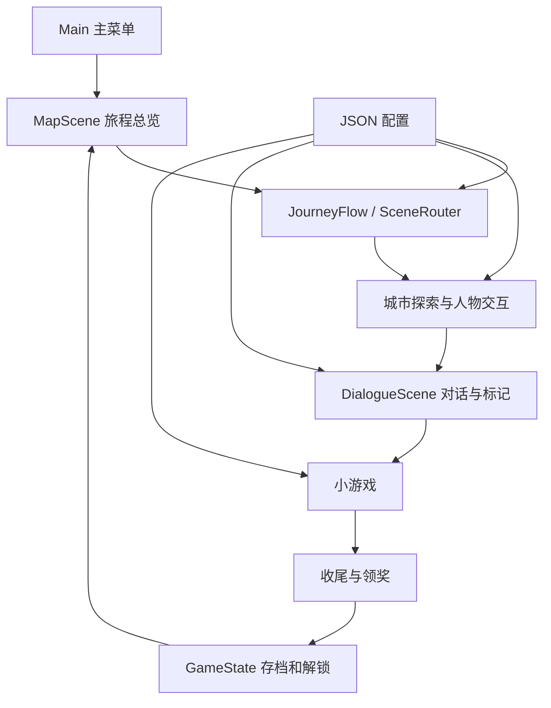

# 架构与代码阅读路线

## 主线推进

奖励受场景上下文控制：独立小游戏可自行结算；城市剧情可以延迟奖励到收尾结束。阅读时同时检查 `SceneRouter.params`、`defer_reward` 与 `JourneyFlow`，区分小游戏完成和城市剧情完成。

## 建议阅读顺序

| 目标 | 入口 | 重点 |
| --- | --- | --- |
| 全局状态 | `game/autoload/GameState.gd`、`game/data/stations.json` | 解锁、碎片、标记、存档与幂等写入 |
| 模块切换 | `game/autoload/SceneRouter.gd`、`JourneyFlow.gd` | 资源检查、场景参数与失败回退 |
| 数据驱动 | `game/core/ContentDB.gd`、`game/data/journeys.json` | 配置如何绑定城市、对话和流程 |
| 城市复用 | `game/scenes/cities/CityScene.gd`、`CityStory.gd`、`NarrativeCity.gd` | 地图外壳、交互与城市差异 |
| 小游戏契约 | `game/puzzles/PuzzleBase.gd`、`game/scenes/puzzles/` | 生命周期、独立 mock 与奖励 |
| 模型互动 | `game/scenes/puzzles/PuzzlePattern.gd` | 六轮规则、识图、笔法与离线状态 |
| 流式解析 | `game/puzzles/PatternSseStream.gd`、`PatternInk.gd` | UTF-8 分片、SSE、增量 JSON 与曲线校验 |
| 稳定绘制 | `game/puzzles/PatternBrushLibrary.gd` | 本地曲线库约束图案结构 |
| 验证 | `game/tests/pattern_llm_mock.py`、`test_pattern_stream.gd` | 超时、401/503、断流与本地回退 |

## 模型互动的约束

大理题库按动物、植物与物品分类。模型作画使用有限笔法命令和本地曲线库，接收命令与逐笔动画并行。遇到鉴权失败、超时、异常响应或断流时，切换到本地预设。识别结果具有不确定性，游戏规则仍由本地代码控制。

公开版保留接入逻辑与公共服务端点，移除了工程内凭据读取路径和私有打包脚本。无素材副本主要用于阅读机制与运行离线协议测试。

## 扩展站点

从 `data/stations.json`、`data/journeys.json` 和城市 JSON 开始，结合 `game/docs/模块接入指南.md` 与 `game/docs/3D地图接入.md` 配置场景、地点、出生点、对话和奖励。地图、人物和图片需自行准备并取得使用权；原文件名与锚点名称仅作为接口参考。

`game/docs/` 保留原工程接入经验，其中的 `drafts/`、素材图册、截图、冻结包及旧测试数字属于未公开的历史材料，不是本次发布证据。以本仓库 `docs/VALIDATION.md` 为准。
