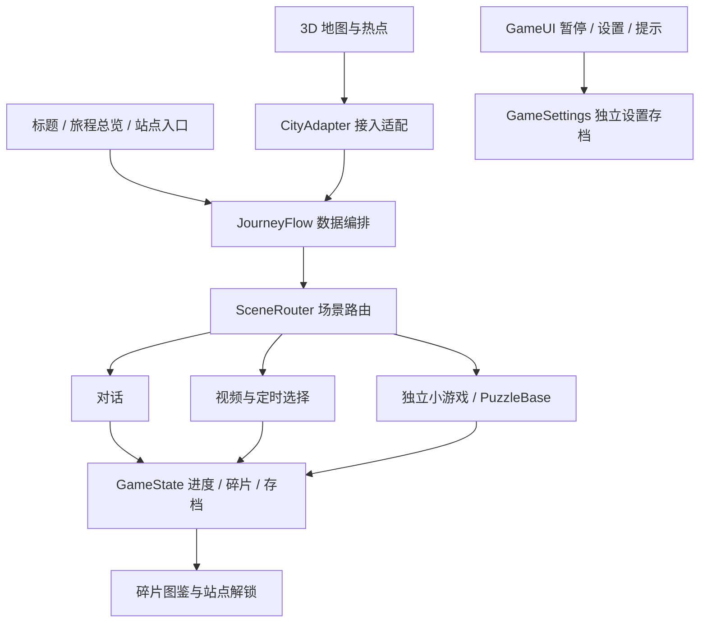

# 《山河信使》整体 UI 与模块接入指南

本轮候选沿用 Godot 4 主工程、原有小游戏 ID 和已确定色板。运行 `game/project.godot` 后按 F5，进入新的玩家主菜单。旧地基测试入口保留在 `tools/DebugMain.tscn`。地图和小游戏继续在各自工程制作；主线通过接口接入。

## 玩家入口

主菜单提供继续旅程、碎片图鉴、声音与显示、重新启程。重新启程先显示清档确认。旅程总览呈现五站解锁状态；点击“走进城市”直接进入 3D 地图出生点；靠近配置的目标地点按 E 启动本站下一段对话或手艺，结束或中途离开回到地图原地点。Esc 打开暂停菜单，计时玩法、转场外的场景处理和视频随之暂停。

五站已接入对应 3D 地图，终站复用丽江且出生于四方街。丽江、香格里拉、大理、普洱已有小游戏；古城拼锦仍待制作。本批接入到出生点与基础热点，逐城 NPC、线索门锁与任务细节仍待完善。图鉴文字为剧情条目，文化考据的正式来源仍需补齐。

## 职责与依赖



| 模块 | 负责什么 | 修改位置 |
| --- | --- | --- |
| GameState | 站点与碎片、剧情标记、原有存档兼容 | `autoload/GameState.gd` |
| SceneRouter | 场景注册、资源预检、阻止重复切换、淡入淡出、错误恢复 | `autoload/SceneRouter.gd` |
| JourneyFlow | 读站点流程、寻找下一步、完成后返回地图原地点、分支动作 | `autoload/JourneyFlow.gd` |
| ContentDB | 只读 JSON 内容访问 | `core/ContentDB.gd` |
| GameUI / GameSettings | 常驻暂停和设置层；设置独立保存 | `autoload/GameUI.gd` / `GameSettings.gd` |
| UiKit | 原有色板、字体、纸卡和按钮的共享组件 | `ui/UiKit.gd` |
| CityAdapter | 3D 热点与主线的连接，地图自管玩家、碰撞、相机 | `core/CityAdapter.gd` |

`stations.json` 继续是站点顺序、碎片归属、解锁与小游戏 key 的事实来源。`puzzles.json` 继续由各小游戏维护。新的 `journeys.json` 只维护剧情顺序、站点简介、预览图和城市场景入口；`fragments.json` 维护图鉴，`dialogues/` 与 `cinematics/` 分开维护。

## 主线流程配置

在 `data/journeys.json` 的站点节点里添加 `flow`：

```json
{
  "map_scene": "res://scenes/cities/lijiang.tscn",
  "flow": [
    {"id": "arrival", "type": "cine", "content": "cine_lijiang_1"},
    {"id": "greeting", "type": "dialogue", "content": "sample_lijiang"},
    {"id": "explore", "type": "map"},
    {"id": "glyph", "type": "puzzle"}
  ]
}
```

这是流程扩展示例；当前配置见 journeys.json。本示例视频和探索步骤尚未加入，不应直接把示例路径当成已完成素材。步骤 `id` 必须在同站内唯一且稳定，已开始使用后不要改名。已完成剧情步骤存入 `flow/<station>/<step>` 标记；小游戏完成以其真实通关状态为准。`JourneyFlow.begin(station_id)` 打开首个未完成步骤。只有真实完成才记进度，缺失素材不会静默跳过。

对话和影像在主线中完成时回到地图原地点，由地点交互继续下一段；玩家中途返回不记该步骤完成。站点手记的独立手艺入口已移除，已有碎片奖励规则保持。存档记录步骤和收集结果，不记录视频播放秒数、对话行号、跨重启的城内坐标或小游戏过程；中途离开后从该模块起点重新进入。

## 地图接入

当前五站出生点、资源来源与基础热点见 [3D地图接入.md](3D地图接入.md)。从地图进入其他模块时用 `city_context` 临时保存位置、相机角度和距离，模块结束/退出使用 `JourneyFlow.return_to_city(station_id)`；不会把位置写入玩家存档。

1. 地图继续在独立 Godot 工程制作，整理好场景、模型、纹理和依赖后复制到主工程的 `scenes/cities/`、`assets/maps/`。合并资源路径，避免把独立工程的 `res://` 根路径当成主工程路径。不复制独立工程 `project.godot`、`.godot` 缓存或其 autoload。
2. 在 `journeys.json` 的 `map_scene` 填入可加载的主工程场景路径。长卷上的站点入口通过路由直接进入该地图出生点。
3. 在城市场景挂一个 Node，脚本使用 `core/CityAdapter.gd`。`station_id` 可手动设置，主线路由时会传入所属站点。
4. 现有地图触发器用下面的接口连接主线，无需依赖其他地图或小游戏实现。

```gdscript
$CityAdapter.open_dialogue("npc_lijiang_intro")
$CityAdapter.open_cine("cine_lijiang_1")
$CityAdapter.open_puzzle()
$CityAdapter.resume_story()
$CityAdapter.return_to_journey()
```

探索步骤只有在地图自己的条件确实达成后调用 `$CityAdapter.finish_exploration()`；这只登记完成，不直接发碎片。地图可订阅 `station_progress_changed` 刷新热点、雾封或提示。暂停菜单已经处理全局暂停；地图玩家脚本保持默认可暂停的 process mode。

## 剧情视频接入

把实际 `.ogv` 文件放到 `assets/cine/`，在 `data/cinematics/<id>.json` 登记。Godot 原生 VideoStreamPlayer 支持 Ogg Theora；其他格式需要扩展插件。依据 [Godot 视频组件文档](https://docs.godotengine.org/en/4.4/classes/class_videostreamplayer.html)。本轮没有转码或安装插件。

```json
{
  "id": "cine_lijiang_1",
  "title": "丽江 · 古道来信",
  "video": "res://assets/cine/lijiang_1.ogv",
  "allow_skip": true,
  "hotspots": [
    {
      "id": "route",
      "at": 12.0,
      "prompt": "接下来走向哪里？",
      "choices": [
        {"label": "沿古道前行", "action": {"type": "flag", "key": "follow_road"}},
        {"label": "留在集市", "on_end": {"type": "dialogue", "dialogue_id": "market_intro"}}
      ]
    }
  ],
  "on_end": {"type": "station", "station": "lijiang"}
}
```

每个选择点必须有唯一 `id` 和至少一个选项；按时间顺序配置。到达时间点会暂停视频并要求选择；即使跳过播放，也需要逐个完成未做的选择，系统不默认替玩家选择。选择记录键为 `<cine_id>/<hotspot_id>`。选项可用 `on_end` 切到另一个影像或对话；主线分支保留当前步骤上下文，到分支模块完成后登记该步骤。直接使用 `SceneRouter.goto_cine(id)` 时采用内容的 `on_end`；主线普通播放完成则回到本站。

`data/cinematics/example.json` 是结构示例，视频字段为空。当前已检查缺失视频回退与选择处理接口；正式影像播放、音画同步及热点时间精度需在真实素材到位后实测。

## 对话接入

对话 JSON 继续沿用现有 `speaker`、`text`、`next`、`choices`、`action` 与 `on_end`。可增加顶层 `title`，单行可填 `portrait: "res://assets/characters/xxx.png"`。不填立绘仍可播放。

正文支持打字机；点击对话框或按 Enter/空格补全、继续，出现分支时必须选择选项。设置页的文字速度即时生效。结束时由主线决定后续；直接播放可使用 `on_end` 的 map / station / puzzle / cine / dialogue / finale / none。

内容 ID 使用普通文件名，不含扩展名或路径。缺失文件显示返回入口；跳转索引不得为负数或超出 lines 长度。`next == lines.size()` 表示结束。分支内容不得形成没有出口的自循环，正式内容须逐段试玩检查。

## 小游戏与结算

现有 5 个 station ID、碎片 ID、场景名和四个生命周期钩子不变。通过 `SceneRouter.goto_puzzle(station_id)` 进入主线会使用真实 GameState；F6 或工具独立实例化时使用内存 mock，不落盘。旧调试脚本仍可单独运行，但旧 `test_gamestate.gd`、`test_main_scene.gd` 是早期诊断脚本，会修改真实存档，常规验证应使用新测试场景。

基类负责说明页、退出、幂等奖励与返回，暂停参数统一到计时器。丽江和普洱已有的最终结算演出保留。香格里拉使用共享结算卡，显示信物名称、意义与图鉴入口提示；音效素材仍待接入。

碎片按所属站结算，不依赖当前站点；未注册碎片不计入图鉴，锁定站点不能提前发奖。集齐该站配置的碎片才会记完成、解锁下一站。古城无碎片，现采用单目标叙事终章：小木因纪录片回来，准备学习后退镜留白；没有拼锦、额外奖励或结局评级。旧`evaluate_ending()`接口保留供历史模块兼容，新终章不调用。详见[古城操作说明](古城操作说明.md)。

## 回归和预览

使用 Godot 4.7.2 实测：

```sh
/Applications/Godot.app/Contents/MacOS/Godot --headless --path game res://tests/ShellTest.tscn
/Applications/Godot.app/Contents/MacOS/Godot --headless --path game res://tests/PuzzleGlyphTest.tscn
/Applications/Godot.app/Contents/MacOS/Godot --headless --path game res://tests/ModulesTest.tscn
/Applications/Godot.app/Contents/MacOS/Godot --path game --position -3000,100 res://tools/ShellPreview.tscn
```

以上命令从项目根目录执行；其他系统用本机 Godot 程序路径。外壳回归用独立测试存档，结束后恢复只读载入玩家存档；小游戏回归使用内存状态。`visual-previews/shell/` 保存窗口截图和测试证据。截图必须使用窗口模式，headless 不产生有效渲染图。

本轮是可继续开发和试玩的源码候选，尚未导出 Windows/macOS 可执行文件，没有公开发布。
